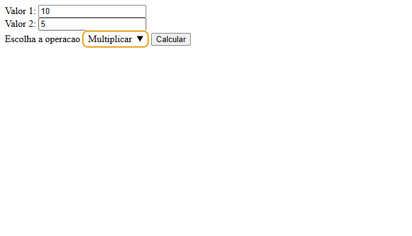
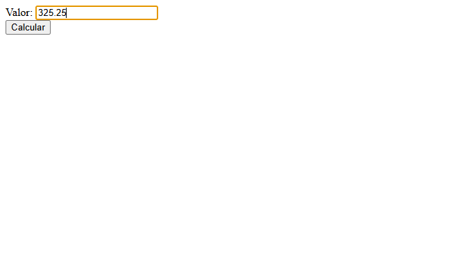

# Monitoria de Programação Web: Exercícios em HTML e JavaScript


Códigos desenvolvidos durante as aulas de monitoria da disciplina de Programação Web no IFSP (Campus Presidente Epitácio). Os exercícios cobrem conceitos básicos de HTML e JavaScript puro com manipulação de formulários, cálculos e funções.

A lista com os enunciados dos exercícios está no arquivo [ProjetoJSeHTML.pdf](ProjetoJSeHTML.pdf).

---

## Capturas de tela

| Exercício 1: Calculadora | Exercício 9: Decomposição de cédulas |
| :---: | :---: |
|  |  |

---

## Lista de exercícios

| # | HTML | JavaScript | Descrição da Atividade |
| :---: | :--- | :--- | :--- |
| **01** | [`html/index.html`](html/index.html) | [`js/main.js`](js/main.js) | Calculadora com duas entradas e seleção de 8 operações (soma, subtração, multiplicação, divisão, potenciação, resto, maior número e média) |
| **02** | [`html/index2.html`](html/index2.html) | [`js/main2.js`](js/main2.js) | Cálculo de valor final de uma compra aplicando percentual |
| **03** | [`html/index3.html`](html/index3.html) | [`js/main3..js`](js/main3..js) | Cálculo de bônus salarial (15% para salários até R$ 5.000,00 e 5% acima desse valor) |
| **04** | [`html/index4.html`](html/index4.html) | [`js/main4.js`](js/main4.js) | Cálculo da média aritmética a partir de duas notas informadas |
| **05** | [`html/index5.html`](html/index5.html) | [`js/main5.js`](js/main5.js) | Conversor de valor em Dólar para Real utilizando a cotação atual |
| **06** | [`html/index6.html`](html/index6.html) | [`js/main6.js`](js/main6.js) | Cálculo da área de um quadrado a partir do tamanho do lado |
| **07** | [`html/index7.html`](html/index7.html) | [`js/main7.js`](js/main7.js) | Cálculo da área de um retângulo a partir de comprimento e largura |
| **08** | [`html/index8.html`](html/index8.html) | [`js/main8.js`](js/main8.js) | Cálculo geométrico a partir do raio de um círculo |
| **09** | [`html/index9.html`](html/index9.html) | [`js/main9.js`](js/main9.js) | Decomposição de um valor em dinheiro nas denominações atuais de cédulas e moedas (R$ 200,00 a R$ 0,01) |

---

## Estrutura do repositório

```text
monitoria-programa-oweb/
├── html/                    # Páginas HTML dos 9 exercícios
├── js/                      # Scripts JavaScript correspondentes
├── images/                  # Capturas de tela das interfaces
├── ProjetoJSeHTML.pdf       # Documento com a proposta dos exercícios
└── README.md
```

---

## Como executar

1. Clone o repositório:
   ```bash
   git clone https://github.com/rtobias-git/monitoria-programa-oweb.git
   ```
2. Abra qualquer arquivo da pasta `html/` (por exemplo, `html/index.html` ou `html/index9.html`) diretamente no seu navegador.

---

## Autor

Desenvolvido por **Tobias Rafael** ([@rtobias-git](https://github.com/rtobias-git)), monitor da disciplina no IFSP Campus Presidente Epitácio.
